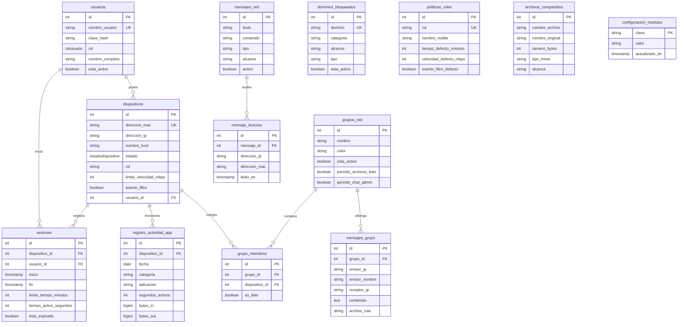

# 🛡️ NetworkLab — Plataforma de Gestión de Red y Control de Laboratorios
### 👩‍💻 Autora, Diseño & Desarrollo: **Nicole Tacuri**
**Prácticas Profesionalizantes — Tecnicatura Superior en Analista de Sistemas ISFT 177**  
*Router MikroTik RouterBOARD 951G-2HnD / hEX (RB750Gr3)*

<p align="center">
  
  
  
  
  
  
</p>

---

## 📖 Resumen Ejecutivo

**NetworkLab** es una solución integral de administración de red y gestión pedagógica para salas de informática, laboratorios universitarios o instituciones educativas. La **idea original, el diseño visual y arquitectónico, la configuración de red y el desarrollo full-stack completo fueron creados e implementados por Nicole Tacuri** como trabajo integrador de la carrera **Tecnicatura Superior en Analista de Sistemas**. La plataforma transforma un router **MikroTik RouterBOARD (RB951G-2HnD / hEX RB750Gr3)** en un controlador inteligente de aula capaz de operar en tiempo real a través de la API binaria de RouterOS (puerto 8728) y RouterOS REST API.

El sistema resuelve los problemas cotidianos de conectividad en entornos académicos:
1. **Control de acceso y autenticación**: Aprobación individual o masiva de estaciones, evitando conexiones no autorizadas mediante aislamiento inmediato en el firewall.
2. **QoS y Control de Ancho de Banda**: Asignación dinámica de colas de velocidad para evitar la saturación de la red.
3. **Filtrado Web en Lista Blanca**: Navegación restringida únicamente a sitios educativos permitidos mediante técnicas avanzadas de RouterOS v7 (DNS Forwarding con comodines y DNS Sinkhole).
4. **Trabajo Colaborativo en el Aula**: Creación visual de mesas/grupos de trabajo con designación de líderes, chat interno en tiempo real y transferencia segura de archivos adjuntos.
5. **Portal Cautivo del Estudiante**: Interfaz responsiva con temporizador regresivo de sesión, visor embebido de guías en PDF y recepción de comunicados docentes con acuse de recibo.

---

## 📑 Tabla de Contenidos

1. [Arquitectura del Sistema (Enfoque Híbrido)](#1-arquitectura-del-sistema-enfoque-híbrido)
2. [Hardware de Red Utilizado](#2-hardware-de-red-utilizado)
3. [Configuración Inicial del Router MikroTik desde Winbox](#3-configuración-inicial-del-router-mikrotik-desde-winbox)
4. [Capa de Persistencia y Base de Datos (Code-First)](#4-capa-de-persistencia-y-base-de-datos-code-first)
5. [Estructura del Proyecto y Descripción de Archivos](#5-estructura-del-proyecto-y-descripción-de-archivos)
6. [Recorrido de Módulos: Panel del Administrador](#6-recorrido-de-módulos-panel-del-administrador)
7. [Recorrido de Módulos: Portal del Alumno](#7-recorrido-de-módulos-portal-del-alumno)
8. [Variables de Entorno (.env)](#8-variables-de-entorno-env)
9. [Instalación y Despliegue con Docker](#9-instalación-y-despliegue-con-docker)
10. [Endpoints Clave de la API REST](#10-endpoints-clave-de-la-api-rest)
11. [Autoría y Créditos del Proyecto](#-autoría-y-créditos-del-proyecto)

---

## 1. Arquitectura del Sistema (Enfoque Híbrido)

El proyecto implementa un **enfoque híbrido desacoplado**: RouterOS ejecuta exclusivamente lo que resuelve a velocidad de cable a nivel kernel (conmutación de paquetes, colas QoS, aislamiento en firewall, reenvío DNS y asignaciones DHCP), mientras que la plataforma en Docker (FastAPI + PostgreSQL + Nginx) provee la lógica de negocio, persistencia relacional, auditoría y experiencia de usuario.

```
       +-------------------------------------------------------------+
       |               DOCENTE / ADMINISTRADOR DE RED                |
       +-------------------------------------------------------------+
                                      │
                                      ▼
                        Panel Web (Nginx - Puerto 3000)
             [index.html / portal.html / doc.html / Three.js / Chart.js]
                                      │
                                      ▼
                   Backend REST API (FastAPI - Puerto 8000)
                     [main.py / routeros_client.py / ORM]
                                 │         │
                 ┌───────────────┘         └────────────────┐
                 ▼                                          ▼
     Base de Datos PostgreSQL (5432)        Router MikroTik (8728 / API)
      [Dispositivos, Sesiones, Grupos,       [DHCP Leases, Address-Lists,
     Mensajes, Roles, Archivos, Log]         Simple Queues, Static DNS FWD]
                                                            │
                                              ┌─────────────┴─────────────┐
                                              ▼                           ▼
                                      Estación Alumno (PC)         Celular / Tablet
                                     [portal.html / PWA]         [Captive Portal / PWA]
```

### Componentes Principales:
* **Frontend Web (Nginx Alpine - Puerto 3000)**: Single Page Application (SPA) desarrollada con Vanilla JavaScript ES6+, hojas de estilo CSS modulares con soporte de **Modo Oscuro Glassmorphism** y **Modo Claro de Alto Contraste** para proyectores de clase. Incluye integración con **Chart.js** para telemetría, **Three.js** para renderizado 3D y **PDF.js** para lectura de documentos sin conexión a internet.
* **Backend API (FastAPI / Python 3.11 - Puerto 8000)**: API asíncrona de alto rendimiento con validación estricta de esquemas Pydantic y pooling de conexiones a PostgreSQL mediante SQLAlchemy. Se comunica bidireccionalmente con RouterOS mediante sockets binarios (puerto 8728) y peticiones REST.
* **Base de Datos Relacional (PostgreSQL 16 Alpine - Puerto 5432)**: Contenedor dedicado que almacena toda la historia de sesiones, auditoría de consumo, perfiles de roles, grupos colaborativos y confirmaciones de lectura.
* **Router de Red (MikroTik RouterBOARD)**: Conmutador y cortafuegos perimetral del laboratorio. Aplica listas de bloqueo dinámicas, limita velocidades por Simple Queues y resuelve consultas DNS locales.

---

## 2. Hardware de Red Utilizado

### Hardware Principal del Laboratorio: **MikroTik RouterBOARD 951G-2HnD**
* **Procesador (CPU)**: Atheros AR9344 a 600 MHz (Arquitectura MIPSBE).
* **Memoria RAM**: 128 MB DDR SDRAM integrada.
* **Almacenamiento Interno**: 128 MB NAND Flash.
* **Puertos Ethernet**: 5 puertos Gigabit Ethernet (10/100/1000 Mbps) con detección automática MDI/X.
* **Módulo Inalámbrico Integrado**: Radio Wi-Fi 2.4 GHz 802.11b/g/n (MIMO 2x2, antenas internas de 2.5 dBi con potencia de hasta 1000 mW).
* **Puerto Adicional**: USB 2.0 tipo A (con soporte para módems 3G/4G o almacenamiento).
* **Sistema Operativo**: RouterOS v7.19.4 (Licencia Level 4).
* **Alimentación**: Jack DC 8-30V o PoE pasivo por puerto `ether1`.

### Modelo Alternativo Compatible: **MikroTik hEX (RB750Gr3)**
* Compatible de forma nativa con modelos de la línea hEX (MediaTek MT7621A dual-core 880 MHz / 256 MB RAM). Al ser un equipo cableado (*wired-only*), los dispositivos Wi-Fi se conectan mediante un Access Point externo conectado a una de sus bocas LAN.

---

## 3. Configuración Inicial del Router MikroTik desde Winbox

Para que el backend interactúe correctamente con el router MikroTik, se deben realizar las siguientes configuraciones desde la interfaz gráfica oficial **Winbox** o mediante la terminal de RouterOS:

```
                            CONFIGURACIÓN WINBOX
 ┌──────────────────────┐   ┌──────────────────────┐   ┌──────────────────────┐
 │    1. IP -> Services │   │   2. System -> Users │   │ 3. IP -> Firewall    │
 │  Habilitar API: 8728 │ → │ Crear usuario api-lab│ → │ Reglas Filter & NAT  │
 └──────────────────────┘   └──────────────────────┘   └──────────────────────┘
                                                                   │
                                                                   ▼
 ┌──────────────────────┐   ┌──────────────────────┐   ┌──────────────────────┐
 │  6. IP -> DHCP Server│   │  5. Queues -> Simple │   │    4. IP -> DNS      │
 │  Rango 10 - 250      │ ← │ Control QoS Dinámico │ ← │ Forwarding & Sinkhole│
 └──────────────────────┘   └──────────────────────┘   └──────────────────────┘
```

### Paso 1: Habilitar el Servicio de API
1. Dirigirse al menú **IP → Services**.
2. Localizar el servicio **`api`** (puerto estándar `8728`).
3. Hacer clic en el botón de tilde azul (**Enable**) para activarlo.
*(Opcional: Si se desea usar la API REST de RouterOS v7, habilitar también el servicio `www-ssl` o `www` en el puerto 80).*

```routeros
/ip service enable api
```

### Paso 2: Crear el Usuario de Gestión para el Backend
1. Ir a **System → Users**.
2. Presionar el botón **`+`** (Add).
3. Configurar:
   * **Name**: `api-lab`
   * **Group**: `full` (o un grupo personalizado con permisos `read`, `write`, `api`, `test`).
   * **Password**: Definir una contraseña segura (la misma que se asignará en la variable `ROUTEROS_PASSWORD` del archivo `.env`).
4. Hacer clic en **Apply** y **OK**.

```routeros
/user add name=api-lab group=full password="TuPasswordSeguro" comment="API Backend NetworkLab"
```

### Paso 3: Reglas de Firewall Filter y Aislamiento
1. Dirigirse a **IP → Firewall → Filter Rules**.
2. **Regla de Bloqueo de No Autorizados**:
   * Presionar **`+`**.
   * **Chain**: `forward`
   * **Advanced → Src. Address List**: `blocked-devices`
   * **Action**: `drop`
   * **Comment**: `Drop blocked and unapproved devices`
3. **Regla de Rechazo de QUIC (UDP 443)**:
   * *Justificación técnica*: Los navegadores modernos (Chrome/Edge) usan el protocolo QUIC (UDP 443) hacia Google/YouTube, el cual no siempre envía el nombre SNI en texto claro y puede provocar demoras de 30 segundos hasta degradar a TCP. Al rechazarlo con `icmp-port-unreachable`, el navegador conmuta a HTTPS TCP estándar de forma instantánea.
   * **Chain**: `forward`
   * **Protocol**: `udp`
   * **Dst. Port**: `443`
   * **Action**: `reject`
   * **Reject With**: `icmp-port-unreachable`
   * **Comment**: `Reject QUIC to enforce standard TLS filtering`

```routeros
/ip firewall filter add chain=forward src-address-list=blocked-devices action=drop comment="Drop blocked and unapproved devices"
/ip firewall filter add chain=forward protocol=udp dst-port=443 action=reject reject-with=icmp-port-unreachable comment="Reject QUIC to enforce standard TLS filtering"
```

### Paso 4: Enmascaramiento NAT (Salida a Internet)
1. Ir a **IP → Firewall → NAT**.
2. Presionar **`+`**.
3. **Chain**: `srcnat`
4. **Out. Interface**: Seleccionar la interfaz de salida a internet (típicamente `ether1` o la interfaz WAN).
5. **Action**: `masquerade`
6. Presionar **Apply** y **OK**.

```routeros
/ip firewall nat add chain=srcnat out-interface=ether1 action=masquerade comment="NAT Masquerade to Internet"
```

### Paso 5: Servidor DNS Local, Reenvío de Lista Blanca y Sinkhole
1. Ir a **IP → DNS**.
2. Activar la casilla **`Allow Remote Requests`**.
3. En **Servers**, ingresar los servidores DNS ascendentes (ej: `8.8.8.8`, `1.1.1.1`).
4. **Configuración de Lista Blanca (Pestaña Static)**:
   * Para cada dominio educativo permitido (ej: YouTube, GitHub, Wikipedia):
     * Presionar **`+`**.
     * **Name**: `youtube.com` (o el dominio deseado).
     * **Type**: `FWD`
     * **Match Subdomain**: Marcar la casilla (equivale a `*.youtube.com`).
     * **Forward To**: `8.8.8.8`
5. **DNS Sinkhole (Bloqueo del resto de internet no autorizado)**:
   * Agregar un registro al final de la lista estática:
     * **Regexp**: `.*`
     * **Address**: `0.0.0.0`
     * **Comment**: `DNS Sinkhole - Bloqueo de dominios fuera de lista blanca`

```routeros
/ip dns set allow-remote-requests=yes servers=8.8.8.8,1.1.1.1
/ip dns static add name=youtube.com type=FWD match-subdomain=yes forward-to=8.8.8.8 comment="Whitelist YouTube"
/ip dns static add name=github.com type=FWD match-subdomain=yes forward-to=8.8.8.8 comment="Whitelist GitHub"
/ip dns static add name=wikipedia.org type=FWD match-subdomain=yes forward-to=8.8.8.8 comment="Whitelist Wikipedia"
/ip dns static add regexp=".*" address=0.0.0.0 comment="DNS Sinkhole"
```

### Paso 6: Configuración del Servidor DHCP
1. Ir a **IP → Pool** y verificar el rango disponible para los alumnos (ej: `192.168.88.10-192.168.88.250`).
2. En **IP → DHCP Server → Networks**, corroborar que la puerta de enlace sea `192.168.88.1` y el DNS asignado a los clientes sea `192.168.88.1` (la IP del propio router para aplicar el filtrado local).
3. **Equipo Docente / Servidor**: Debe poseer una IP fija fuera del rango dinámico o con reserva estática (por diseño del proyecto: `192.168.88.252`).

---

## 4. Capa de Persistencia y Base de Datos (Code-First)

El sistema utiliza una arquitectura de datos moderna y profesional basada en el patrón **Code-First con SQLAlchemy ORM**, erradicando el uso de archivos `.sql` sueltos y scripts artesanales incrustados en el código.

### 4.1 Principios de Diseño
* **Zero SQL Files**: No existen archivos `.sql` en el repositorio. Toda la estructura de datos se encuentra expresada en clases tipadas de Python en [`backend/app/models.py`](backend/app/models.py).
* **Auto-Aprovisionamiento Declarativo**: Al iniciarse el contenedor del backend, SQLAlchemy ejecuta `Base.metadata.create_all(bind=engine)`, verificando la existencia de cada tabla, columna, clave foránea y tipo enumerado en PostgreSQL, creándolos automáticamente si es un despliegue nuevo.
* **Inmunidad frente a Inyecciones SQL**: El 100% de las consultas en los controladores de la API se ejecutan mediante métodos del ORM (`db.query()`, `filter()`, `db.add()`). Estas llamadas son compiladas por SQLAlchemy en consultas SQL preparadas (*Prepared Statements*) con paso de parámetros tipados, imposibilitando la concatenación de entradas de usuario.
* **Mantenimiento Automatizado en Arranque**: En [`backend/app/main.py`](backend/app/main.py), la función `inicializar_datos_sistema()` siembra las políticas base de roles, el usuario administrador por defecto y cierra sesiones obsoletas de días anteriores usando objetos y deltas de tiempo de Python (`timedelta(hours=12)`).

### 4.2 Diagrama Entidad-Relación (DER)



### 4.3 Diccionario de Datos del Sistema

| Tabla | Propósito Funcional | Clave Primaria (PK) | Claves Foráneas (FK) y Relaciones |
| :--- | :--- | :--- | :--- |
| `usuarios` | Cuentas de acceso (Administrador, Docente, Alumno). | `id` (Integer) | 1:N con `dispositivos` y `sesiones`. |
| `dispositivos` | Estaciones físicas detectadas por MAC e IP en el laboratorio. | `id` (Integer) | `usuario_id` → `usuarios.id`. 1:N con `sesiones`. |
| `sesiones` | Intervalos continuos de conexión con cómputo de tiempos activos. | `id` (Integer) | `dispositivo_id` → `dispositivos.id`, `usuario_id` → `usuarios.id`. |
| `dominios_bloqueados` | Lista blanca de sitios web sincronizados con RouterOS DNS. | `id` (Integer) | Sin dependencias (índice único en `dominio`). |
| `politicas_roles` | Perfiles de QoS (límites de tiempo, velocidad y permisos por rol). | `id` (Integer) | Sin dependencias (índice único en `rol`). |
| `grupos_red` | Mesas de trabajo colaborativas creadas dinámicamente en clase. | `id` (Integer) | 1:N con `grupo_miembros` y `mensajes_grupo`. |
| `grupo_miembros` | Asociación entre puestos y grupos con designación de líder. | `id` (Integer) | `grupo_id` → `grupos_red.id`, `dispositivo_id` → `dispositivos.id`. |
| `mensajes_grupo` | Mensajería interna y archivos adjuntos compartidos en el grupo. | `id` (Integer) | `grupo_id` → `grupos_red.id` (ON DELETE CASCADE). |
| `archivos_compartidos` | Material didáctico (PDFs, guías, código) subido por el docente. | `id` (Integer) | Archivos guardados en volumen local desacoplado de la BD. |
| `mensajes_red` | Comunicados generales y alertas emitidas por el administrador. | `id` (Integer) | 1:N con `mensaje_lecturas`. |
| `mensaje_lecturas` | Acuses de recibo auditables para la métrica de lectura $x/y$. | `id` (Integer) | `mensaje_id` → `mensajes_red.id` (ON DELETE CASCADE). |
| `registro_actividad_app` | Telemetría consolidada de aplicaciones (juegos, streaming, estudio). | `id` (Integer) | `dispositivo_id` → `dispositivos.id` (ON DELETE CASCADE). |
| `configuracion_modulos` | Parámetros globales clave-valor para banderas de módulos. | `clave` (String) | Tabla de configuración de sistema. |

---

## 5. Estructura del Proyecto y Descripción de Archivos

```
Laboratorio2-Tacuri/
├── backend/
│   ├── app/
│   │   ├── routers/                # Controladores modulares de la API REST
│   │   │   ├── activity.py         # Auditoría e historial de actividad por equipo
│   │   │   ├── auth.py             # Autenticación administrativa y tokens JWT
│   │   │   ├── devices.py          # Gestión, aprobación y limpieza de dispositivos
│   │   │   ├── files.py            # Subida, streaming y visualización de guías PDF
│   │   │   ├── groups.py           # Grupos colaborativos, chat y descarga de archivos
│   │   │   ├── messages.py         # Comunicados docentes y acuse de lectura x/y
│   │   │   ├── portal.py           # Endpoints de telemetría para el portal del alumno
│   │   │   ├── roles.py            # Políticas de roles y sincronización de QoS
│   │   │   ├── sessions.py         # Control de tiempos de sesión y pulso de actividad
│   │   │   ├── stats.py            # Telemetría, KPIs y estado del router
│   │   │   └── web_filter.py       # Reglas de lista blanca y reenvío DNS
│   │   ├── auth.py                 # Funciones criptográficas (Bcrypt y JWT)
│   │   ├── config.py               # Carga tipada de variables de entorno (Pydantic)
│   │   ├── database.py             # Motor SQLAlchemy, SessionLocal y dependencias
│   │   ├── models.py               # Modelos declarativos ORM de la base de datos
│   │   ├── routeros_client.py      # Cliente de comunicación con MikroTik (API 8728)
│   │   └── main.py                 # Entrada FastAPI, middlewares y orquestación
│   ├── Dockerfile                  # Construcción de imagen de Python 3.11
│   └── requirements.txt            # Dependencias del backend
├── frontend/
│   ├── css/
│   │   └── style.css               # Estilos globales (Glassmorphism / Modo Claro)
│   ├── js/
│   │   ├── app.js                  # Lógica y controladores del panel del docente
│   │   ├── chart.js                # Librería gráfica para telemetría de red
│   │   ├── login.js                # Lógica del formulario de acceso docente
│   │   ├── OrbitControls.js        # Control orbital de cámara para el visor 3D
│   │   ├── pdf.min.js              # Motor de renderizado de PDFs en navegador
│   │   ├── pdf.worker.min.js       # Worker secundario para procesamiento de PDFs
│   │   ├── portal.js               # Lógica del portal del estudiante y chat grupal
│   │   └── three.min.js            # Motor 3D WebGL para el visor del router
│   ├── img/
│   │   └── mikrotik.jpg            # Imágenes de referencia del dispositivo
│   ├── doc.html                    # Documentación técnica interactiva con modelo 3D
│   ├── index.html                  # Panel de control principal del administrador
│   ├── login.html                  # Pantalla de inicio de sesión docente
│   ├── portal.html                 # Portal cautivo interactivo para alumnos
│   ├── sw.js                       # Service Worker para notificaciones push nativas
│   ├── favicon.ico                 # Icono de navegador clásico
│   ├── favicon.png                 # Icono de navegador en alta resolución
│   ├── favicon.svg                 # Icono vectorial escalable
│   └── Dockerfile                  # Contenedor de frontend servido con Nginx
├── docker-compose.yml              # Orquestador multi-contenedor
└── README.md                       # Documentación central del repositorio
```

---

## 6. Recorrido de Módulos: Panel del Administrador

El panel de administración (`http://localhost:3000` o `http://192.168.88.252:3000`) es el centro de control del docente para monitorear y gobernar el aula:

```
+----------------------------------------------------------------------------------------------------+
|  🛡️ NetworkLab Admin       [CPU: 4%] [RAM: 42MB] [Uptime: 3d 14h]        [🌙/☀️]  [Sincronizar 🔄]  |
+----------------------------------------------------------------------------------------------------+
|  [01 Dispositivos]   [02 Ancho Banda]   [03 Filtro Web]   [04 Grupos]   [05 Archivos]  [06 Avisos] |
+----------------------------------------------------------------------------------------------------+
|                                                                                                    |
|  KPIs en Vivo:                                                                                     |
|  ┌──────────────────┐  ┌──────────────────┐  ┌──────────────────┐  ┌──────────────────┐            |
|  │ Conectados: 18   │  │ Aprobados: 16    │  │ Tráfico: 24 Mbps │  │ Alertas: 0       │            |
|  └──────────────────┘  └──────────────────┘  └──────────────────┘  └──────────────────┘            |
|                                                                                                    |
|  Tabla de Dispositivos Conectados:                    [🔍 Buscar...]   [🧹 Limpiar Inactivos]      |
|  ┌───────┬───────────────────┬───────────────┬────────────┬─────────┬──────────────┬─────────────┐ |
|  │ Host  │ IP                │ MAC           │ Rol        │ Tiempo  │ Estado       │ Acciones    │ |
|  ├───────┼───────────────────┼───────────────┼────────────┼─────────┼──────────────┼─────────────┤ |
|  │ PC-01 │ 192.168.88.102    │ 70:85:C2:...  │ Nivel 1    │ 118 min │ ✅ Aprobado   │ [Editar]    │ |
|  │ PC-02 │ 192.168.88.105    │ 16:13:C0:...  │ Nivel 1    │ --      │ ⏳ Pendiente  │ [Aprobar]   │ |
|  │ ADMIN │ 192.168.88.252    │ 48:E7:DA:...  │ Admin      │ ∞       │ 🛡️ Servidor  │ [Protegido] │ |
|  └───────┴───────────────────┴───────────────┴────────────┴─────────┴──────────────┴─────────────┘ |
+----------------------------------------------------------------------------------------------------+
```

### Secciones del Panel:
1. **Barra Superior y Telemetría en Tiempo Real**:
   * Indicadores de carga de CPU, uso de memoria RAM del MikroTik y uptime del sistema.
   * Botón de alternancia entre **Modo Oscuro** (Glassmorphism moderno) y **Modo Claro** (alto contraste para proyectores).
   * Botón de sincronización manual instantánea con el router.
2. **Módulo 01: Dispositivos y Control de Acceso**:
   * Detección en vivo de nuevas concesiones DHCP.
   * Botón **Aprobar**: Aplica la cola de velocidad QoS en MikroTik, asigna el tiempo límite, remueve el equipo de `blocked-devices` y convierte la IP en una reserva estática por MAC para evitar colisiones.
   * Botón **Rechazar / Bloquear**: Envía la IP del equipo a la lista `blocked-devices`, cortando su salida a internet de inmediato.
   * Botón **Limpiar Inactivos**: Inspecciona las concesiones activas de MikroTik y depura de la base de datos y de la tabla ARP los equipos que ya no están conectados físicamente, **preservando siempre al equipo docente (`192.168.88.252`)**.
3. **Módulo 02: Control de Ancho de Banda y Políticas de Roles**:
   * Configuración de los roles del aula (`nivel_1` para alumnos estándar, `nivel_2` para docentes o ayudantes, `admin` para control total).
   * Definición de límites simétricos o asimétricos (ej: 5 Mbps, 10 Mbps, 15 Mbps o Ilimitado).
   * Al modificar una política, el backend actualiza de forma automática e inmediata todas las Simple Queues activas en el MikroTik sin requerir reinicios.
4. **Módulo 03: Filtrado Web Educativo (Lista Blanca)**:
   * Visualización y agregado de plataformas educativas autorizadas (ej. YouTube, GitHub, Wikipedia, Google Classroom).
   * Alcance configurable: general para todo el aula o exclusivo para roles seleccionados.
   * Sincronización transparente con el reenvío DNS (`FWD` con `match-subdomain=yes`) y protección DNS Sinkhole en el router.
5. **Módulo 04: Grupos de Trabajo Colaborativos**:
   * Formación ágil de equipos o mesas de trabajo con paleta de colores distintiva.
   * Selector dinámico de miembros con desplazamiento horizontal y vertical fluido.
   * Designación de un **Líder de Equipo** con permisos especiales para subir material didáctico.
   * Chat interno supervisado con intercambio seguro de archivos adjuntos.
6. **Módulo 05: Distribución de Material Didáctico**:
   * Carga de guías prácticas, ejercicios y archivos de código (PDF, ZIP, DOCX, PY, etc.).
   * Visor PDF integrado (**PDF.js**) que permite consultar los documentos directamente en pantalla sin requerir lectores externos ni salida a internet.
7. **Módulo 06: Comunicados y Alertas en Red**:
   * Difusión de anuncios con tres niveles de prioridad: *Informativo*, *Aviso* o *Urgente*.
   * Notificaciones sonoras mediante Web Audio API y vibración en dispositivos móviles.
   * Métrica en tiempo real con contador de acuse de recibo:
     $$\text{👁️ Alumnos que confirmaron lectura} \text{ / } \text{Total conectados} \quad (\%)$$
8. **Módulo 07: Historial y Auditoría de Actividad**:
   * Registro histórico del consumo de datos (Bytes In / Bytes Out) por puesto.
   * Clasificación de tráfico por categorías (estudio, navegación, multimedia) para detectar dispersión de los alumnos.
9. **Módulo 08: Telemetría Gráfica en Tiempo Real**:
   * Gráficos dinámicos con Chart.js que muestran el rendimiento de las interfaces Gigabit del router (`ether1` a `ether5`).

---

## 7. Recorrido de Módulos: Portal del Alumno

El estudiante accede desde cualquier navegador a la dirección `http://192.168.88.252:3000/portal.html`. La interfaz se adapta dinámicamente según el estado de la estación:

```
                           PORTAL DEL ESTUDIANTE
   ┌─────────────────────────────────────────────────────────────────┐
   │ 🛡️ NetworkLab Portal        Estación: PC-04 (192.168.88.104)    │
   ├─────────────────────────────────────────────────────────────────┤
   │                                                                 │
   │  ESTADO APROBADO: Sesión Activa                                 │
   │  ┌───────────────────────────────────────────────────────────┐  │
   │  │  ⏱️ Tiempo Restante:  01:45:22                            │  │
   │  │  [██████████████████████████████████░░░░░░░░░]  78%       │  │
   │  │  Velocidad Asignada: 10 Mbps Simétricos                   │  │
   │  └───────────────────────────────────────────────────────────┘  │
   │                                                                 │
   │  ┌─────────────────────────────┐ ┌───────────────────────────┐  │
   │  │ 👥 Mi Grupo: Mesa 2 (Azul)   │ │ 📢 Comunicados Recientes  │  │
   │  │ Líder: Alumno 3              │ │ "Entregar TP antes de 20h│  │
   │  │ [Abrir Chat de Grupo]        │ │ [✓ Marcar como leído]    │  │
   │  └─────────────────────────────┘ └───────────────────────────┘  │
   │                                                                 │
   │  ┌───────────────────────────────────────────────────────────┐  │
   │  │ 📂 Guías de Trabajo Práctico:                             │  │
   │  │ • TP2_Enrutamiento_MikroTik.pdf       [Ver Guía] [Bajar]  │  │
   │  └───────────────────────────────────────────────────────────┘  │
   └─────────────────────────────────────────────────────────────────┘
```

### Estados y Funcionalidades del Alumno:
1. **Sala de Espera Interactiva (Estado Pendiente)**:
   * Si la PC o celular aún no fue aprobado por el docente, la pantalla muestra una animación de radar sincronizado indicando su dirección IP y nombre de host.
   * El portal realiza sondeos automáticos en segundo plano; en cuanto el docente hace clic en "Aprobar", la interfaz transiciona de inmediato sin requerir recargar la página.
2. **Temporizador de Sesión y Advertencias Preventivas**:
   * Contador regresivo visible con barra de progreso.
   * Al restar **3 minutos**, el sistema emite una alerta sonora y visual preventiva para que el alumno guarde su trabajo.
   * Al expirar el tiempo, el router bloquea el tráfico y el portal ofrece un botón para solicitar una extensión de tiempo.
3. **Chat de Grupo y Descarga de Archivos**:
   * Los alumnos asignados a un grupo de trabajo colaborativo pueden enviarse mensajes y consultar los archivos compartidos por el líder de su equipo.
   * Descarga verificada y segura de archivos adjuntos mediante el endpoint `/groups/chat/archivo/{id}`.
4. **Visor de Material Embebido**:
   * Lectura de consignas y manuales PDF directamente en la pantalla con controles de zoom, paginación y pantalla completa sin depender de internet.
5. **Notificaciones Push y Acuse de Recibo**:
   * Recepción de comunicados incluso si la pestaña está minimizada gracias al **Service Worker** (`sw.js`).
   * Botón `✓ Marcar como leído` para confirmar la recepción del aviso al docente.

---

## 8. Variables de Entorno (.env)

El proyecto se configura mediante un único archivo `.env` ubicado en la raíz del proyecto. Para configurarlo, crea el archivo `.env` siguiendo esta plantilla de referencia:

```env
# ==============================================================================
# 1. CONFIGURACIÓN DEL ROUTER MIKROTIK
# ==============================================================================
# Dirección IP local del router MikroTik (Gateway del laboratorio)
ROUTEROS_HOST=192.168.88.1

# Puerto de la API binaria de RouterOS (estándar: 8728)
ROUTEROS_PORT=8728

# Credenciales del usuario con permisos API creado en System -> Users
ROUTEROS_USER=api-lab
ROUTEROS_PASSWORD=TuPasswordSeguroDelRouter

# ==============================================================================
# 2. LOCALIZACIÓN Y ZONA HORARIA
# ==============================================================================
# Zona horaria para sincronización de logs y auditoría de sesiones
TIMEZONE=America/Argentina/Buenos_Aires

# ==============================================================================
# 3. BASE DE DATOS POSTGRESQL (CONTENEDOR lab_db)
# ==============================================================================
POSTGRES_USER=labuser
POSTGRES_PASSWORD=NetworkLabPassword123
POSTGRES_DB=labdb

# URL de conexión SQLAlchemy consumida por el backend
DATABASE_URL=postgresql://labuser:NetworkLabPassword123@db:5432/labdb

# Puerto expuesto en el equipo anfitrión para PostgreSQL
DB_PORT=5432

# ==============================================================================
# 4. PUERTOS DE SERVICIOS WEB
# ==============================================================================
# Puerto de la API REST de FastAPI
BACKEND_PORT=8000

# Puerto del servidor web Nginx (Panel del docente y portal de alumnos)
FRONTEND_PORT=3000

# ==============================================================================
# 5. SEGURIDAD Y PROTECCIÓN DEL ADMINISTRADOR
# ==============================================================================
# Dirección MAC del equipo docente / servidor (separadas por coma si hay más de una)
# Este equipo NUNCA será bloqueado ni eliminado por los procesos de limpieza
ADMIN_MACS=48:E7:DA:0B:CB:27
```

### Detalle de Variables:

| Variable | Descripción | Valor Típico / Ejemplo |
| :--- | :--- | :--- |
| `ROUTEROS_HOST` | Dirección IP de administración del router MikroTik. | `192.168.88.1` |
| `ROUTEROS_PORT` | Puerto de escucha del servicio `api` de RouterOS. | `8728` |
| `ROUTEROS_USER` | Usuario configurado en RouterOS con grupo `write` o `full`. | `api-lab` |
| `ROUTEROS_PASSWORD` | Contraseña asignada al usuario de la API en RouterOS. | `NetworkLab` |
| `TIMEZONE` | Identificador de zona horaria IANA para marcas de tiempo. | `America/Argentina/Buenos_Aires` |
| `POSTGRES_USER` | Usuario maestro del contenedor de base de datos PostgreSQL. | `labuser` |
| `POSTGRES_PASSWORD` | Contraseña del usuario de base de datos. | `NetworkLab` |
| `POSTGRES_DB` | Nombre de la base de datos relacional del laboratorio. | `labdb` |
| `DATABASE_URL` | Cadena de conexión para el ORM de SQLAlchemy. | `postgresql://labuser:NetworkLab@db:5432/labdb` |
| `DB_PORT` | Puerto de escucha en el host para conectarse a PostgreSQL. | `5432` |
| `BACKEND_PORT` | Puerto donde FastAPI atiende peticiones REST. | `8000` |
| `FRONTEND_PORT` | Puerto donde Nginx sirve las páginas web. | `3000` |
| `ADMIN_MACS` | Direcciones MAC protegidas de firewall y de limpieza. | `48:E7:DA:0B:CB:27` |

---

## 9. Instalación y Despliegue con Docker

### Requisitos Previos:
* **Docker Engine** (v20.10 o superior) y **Docker Compose** (v2 o superior) instalados en el equipo servidor.
* Router MikroTik encendido y conectado físicamente mediante cable de red al equipo docente.
* Configuración inicial de Winbox completada ([Sección 3](#3-configuración-inicial-del-router-mikrotik-desde-winbox)).

### Pasos para Desplegar el Sistema:

1. **Clonar el repositorio**:
   ```bash
   git clone https://github.com/tu-usuario/Laboratorio2-Tacuri.git
   cd Laboratorio2-Tacuri
   ```

2. **Crear el archivo de configuración `.env`**:
   Crear el archivo `.env` en la raíz del proyecto completando las variables según tu red:
   ```bash
   nano .env
   ```

3. **Compilar y levantar los contenedores con Docker Compose**:
   ```bash
   docker-compose up --build -d
   ```

4. **Verificar que todos los servicios estén en estado saludable**:
   ```bash
   docker-compose ps
   ```
   Deberás observar tres contenedores activos:
   * `lab_db`: PostgreSQL 16 Alpine (saludable / puerto `5432`).
   * `lab_backend`: FastAPI / Uvicorn (puerto `8000`).
   * `lab_frontend`: Nginx Alpine (puerto `3000`).

5. **Acceder a las Plataformas**:
   * **Panel del Docente**: `http://localhost:3000` (o `http://192.168.88.252:3000`)
   * **Portal del Estudiante**: `http://localhost:3000/portal.html` (o `http://192.168.88.252:3000/portal.html`)
   * **Documentación Técnica Interactiva con Visor 3D**: `http://localhost:3000/doc.html`
   * **Documentación Swagger de la API**: `http://localhost:8000/docs`

---

## 10. Endpoints Clave de la API REST

| Método | Endpoint | Descripción Funcional |
| :--- | :--- | :--- |
| `POST` | `/auth/token` | Autenticación docente y entrega de credencial JWT Bearer. |
| `GET` | `/devices/` | Lista todos los dispositivos detectados con roles y estados. |
| `POST` | `/devices/sync` | Sondeo y sincronización forzada con DHCP Leases de MikroTik. |
| `POST` | `/devices/{id}/approve` | Autoriza la estación, asigna rol, tiempo y crea Simple Queue. |
| `POST` | `/devices/{id}/reject` | Corta el acceso a internet agregando el equipo a `blocked-devices`. |
| `POST` | `/devices/limpiar-inactivos` | Depura leases inactivas preservando permanentemente al docente. |
| `GET` | `/roles/politicas` | Consulta de políticas por rol (tiempo, QoS, lista blanca). |
| `PUT` | `/roles/politicas/{rol}` | Modifica una política y propaga la velocidad a MikroTik en vivo. |
| `GET` | `/groups/` | Lista los grupos colaborativos, miembros y líderes asignados. |
| `POST` | `/groups/` | Crea un nuevo grupo de trabajo con color distintivo. |
| `GET` | `/groups/{id}/chat` | Mensajes del chat grupal en tiempo real. |
| `POST` | `/groups/{id}/chat` | Envío de mensajes y archivos adjuntos dentro del grupo. |
| `GET` | `/groups/chat/archivo/{id}` | Descarga directa y segura de archivos compartidos en el chat. |
| `GET` | `/web-filter/` | Lista blanca de dominios educativos autorizados. |
| `POST` | `/web-filter/` | Agrega un dominio y lo sincroniza con RouterOS DNS FWD. |
| `DELETE` | `/web-filter/{id}` | Elimina un dominio de la lista blanca y de MikroTik. |
| `POST` | `/files/upload` | Carga de material pedagógico para distribución a alumnos. |
| `GET` | `/files/{id}/view` | Streaming de documentos con soporte para visor PDF.js. |
| `GET` | `/messages/` | Comunicados docentes con contador de confirmación de lectura $x/y$. |
| `POST` | `/messages/{id}/read` | Registra el acuse de recibo del comunicado por parte del alumno. |
| `GET` | `/activity/devices` | Métricas de auditoría histórica y categorización de aplicaciones. |
| `GET` | `/stats/dashboard` | Telemetría general del aula, KPIs y estado del hardware MikroTik. |
| `GET` | `/portal/status` | Endpoint de telemetría consumido por el portal del alumno por IP. |

---

## 👩‍💻 Autoría y Créditos del Proyecto

Este proyecto fue ideado, diseñado y desarrollado íntegramente por:

* **Autora y Desarrolladora**: **Nicole Tacuri**
* **Rol**: Concepción de la idea original, arquitectura de software en capas, diseño de interfaz de usuario (UI/UX), ingeniería de red y políticas de firewall en MikroTik RouterOS, y desarrollo Full-Stack integral (FastAPI, PostgreSQL 16, Vanilla JS, Three.js y Docker Compose).
* **Carrera**: **Tecnicatura Superior en Analista de Sistemas ISFT 177**
* **Materia**: **Prácticas Profesionalizantes III**

---

<p align="center">
  <strong>NetworkLab</strong> — Ideado, Diseñado y Desarrollado por <strong>Nicole Tacuri</strong>.<br>
  <em>Tecnicatura Superior en Analista de Sistemas ISFT 177 · Prácticas Profesionalizantes III</em><br>
  <em>MikroTik RouterBOARD · FastAPI · PostgreSQL · Nginx · Three.js</em>
</p>
